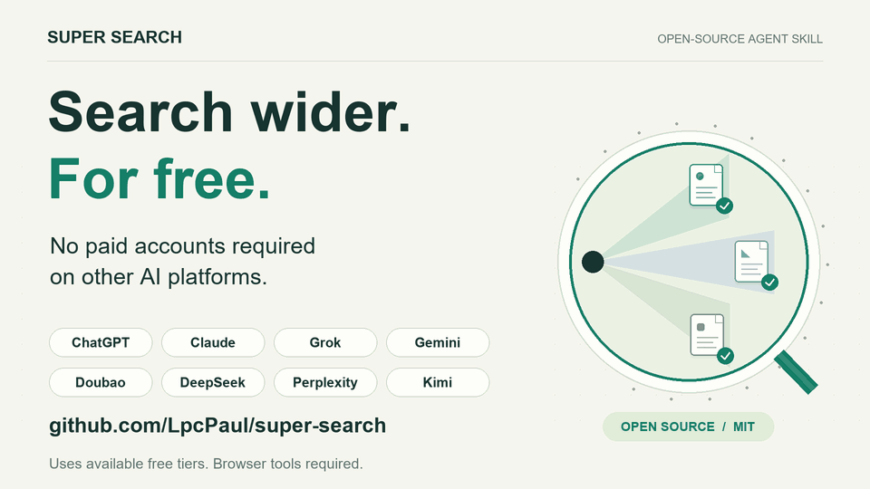

# 超级搜索

[English](README.md)

**免费拓展检索范围，增强检索能力，不依赖其他 AI 平台的付费账号。**



超级搜索是通过多个 AI 网页检索原始资料的 Agent Skill。利用各平台可用的免费搜索能力，补充单个平台可能遗漏的来源，再去重、核验原文。无需购买目标平台会员、接入付费搜索 API 或订阅深度研究服务。

重点是找到更切题、有增量、可追溯的论文、文章、课程、项目和原始帖子，并给出直接链接与原文核验结果。

## 工作方式

1. 把同一个研究问题和约束提交给选定平台。
2. 使用用户已登录的 Chrome 会话，不依赖模型 API Key。
3. 收集资料链接，保留每个平台的独有发现。
4. 去重、核对重要原文，再给出资料清单与实际搜索覆盖情况。
5. 完成后关闭本轮检索与原文核验新开的全部标签，保留用户原有标签和明确要求保留的页面。等待登录或尚未完成的任务保留必要标签，恢复并完成后再清理。

AI 自己写出的长篇回答、模型之间的一致意见，不能代替原始资料。

## 支持平台与调用方判断

默认候选池包含 **ChatGPT、Claude、Grok、Gemini、豆包、DeepSeek、Perplexity、Kimi**。

| 当前调用方 | 默认检索目标 |
| --- | --- |
| Codex / ChatGPT | 除 ChatGPT 外的七家 |
| Claude / Claude Code / Claude Desktop / Cowork | 除 Claude 外的七家，包含 ChatGPT |
| Gemini、Grok、豆包、DeepSeek、Perplexity、Kimi | 排除自身对应网页，使用其余七家 |
| 其他代理或身份未知 | 全部八家，并说明身份识别的不确定性 |

用户明确指定的平台名单优先。将 Codex 与 ChatGPT 放在同一排除组是默认路由约定，不表示两者的搜索能力相同。Grok 在普通网络检索之外，额外查找相关公开 X/Twitter 帖子及其外链。

## 运行条件

- 宿主 AI 能读取 `SKILL.md` 并操作网页。
- 已连接能够访问用户 Chrome 会话的浏览器控制工具。
- 目标平台账号或访客访问可用，并受平台当前地区、权限和额度限制。

本仓库交付的是**流程指令**，不附带浏览器驱动、扩展或独立搜索程序。仅在普通聊天中粘贴本指令，不会自动获得浏览器能力。Codex 可使用已提供的 Chrome 工具，Claude 可使用已连接的 Claude in Chrome；其他宿主需要等效的浏览器连接。

默认使用**免费可用的普通搜索模式**。目标平台提供免费账号或访客搜索时，即可使用；付费账号不构成前提。免费不等于免登录或无限额度：某个平台免费能力不可用或额度耗尽时，标明缺口并继续其他渠道，不要求用户升级会员。

skill 本身不要求模型 API Key。深度研究仅在用户明确要求且现有账号已经具备权限和额度时使用，不自动购买订阅或切换付费 API。宿主 AI 和浏览器工具是否收费，取决于用户选择的运行环境；本项目的免费价值指外部检索渠道无需额外付费。

## 安装

将本仓库内容放入宿主支持的技能目录，保持 `SKILL.md` 位于 `super-search` 文件夹根部。常见个人目录如下：

| 宿主 | 技能目录 |
| --- | --- |
| Codex | `~/.codex/skills/super-search/` |
| Claude Code | `~/.claude/skills/super-search/` |
| 其他代理 | 使用其文档指定的 Agent Skills 目录 |

`agents/openai.yaml` 是 Codex 可选的展示配置；执行规则集中在 `SKILL.md`，不依赖作者电脑上的私有路径或本地技能。

## 使用示例

```text
使用 $super-search，查找如何用图像解释关系、逻辑和原理的方法。
重点返回原始教材、作者文章和课程，不要用你自己的长篇归纳代替资料。
```

支持自动选择技能的宿主，也可使用自然语言：

```text
这些搜索结果没有找到重点，执行一次超级搜索，继续找原始资料。
```

可指定平台、语言、资料类型和已经知道的内容。需要登录时由用户处理；不可访问、额度不足、联网未确认的平台都会如实标注。

## 交付内容

默认在聊天中给出精选资料、匹配理由、独有发现、原文核验范围和实际平台覆盖。只有用户要求保存，或项目已有相应约定时，才创建文件和报告。

评价搜索渠道时，比较它们找到的资料，不将文笔、模型自编示例或自行归纳的质量混入检索能力评价。

## 隐私与边界

- 检索任务会发送给选定的第三方服务，并可能保留在其账号历史中；临时标签不等于无痕或不留存。
- 仅传递任务所需的最小上下文，不传递凭据、Cookie、无关私人历史或整份私有知识库。
- 登录、多重验证和验证码交还用户处理。
- 网站界面变化、地区限制和账号额度可能中断执行，不保证所有宿主和平台的实时兼容性。
- 模型自述“已联网”不等于已验证，出现引用也不等于结论正确；重要发现仍需核对原文。

## 贡献

反馈平台问题时，说明宿主、浏览器、实际界面、失败表现和恢复步骤。提交前清除账号标识、私人任务、历史对话和凭据。新增平台与实际检索质量应分别验证。

## 许可证

[MIT](LICENSE)。平台名称仅用于识别服务，本项目与所列平台无隶属关系。
